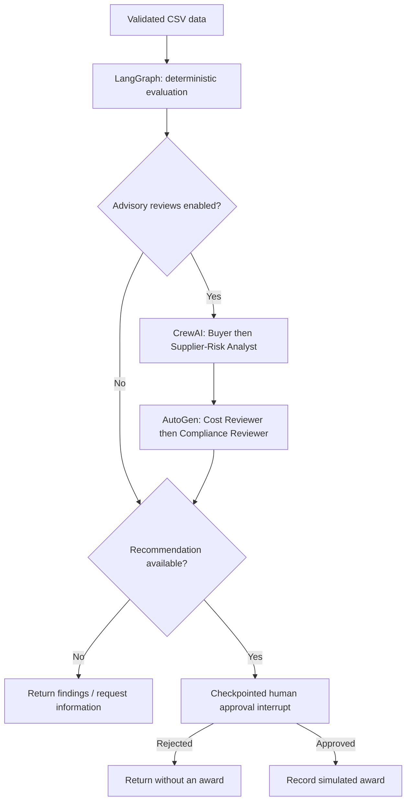

# Workflow architecture

`build_graph()` defaults to the offline deterministic path. Setting
`include_advisory_reviews=True` adds both reviewers in sequence before the approval
gate; invoke that graph with `ainvoke()` because the AutoGen node is asynchronous.
Both reviewers receive the same validated evaluation and source facts, return
structured advisory output, and cannot change the deterministic recommendation or
record an award.

The approval node pauses with a LangGraph interrupt. Resume the same thread with an
explicit `{"approved": true}` decision. `MemorySaver` is the default checkpointer;
pass a durable LangGraph checkpointer to `build_graph(checkpointer=...)` when a
workflow must resume across process restarts. An award is only recorded by the node
after an affirmative human decision.

The companion [architecture image](./architecture.png) is a high-level overview;
this document describes the executable graph and its ordering.
